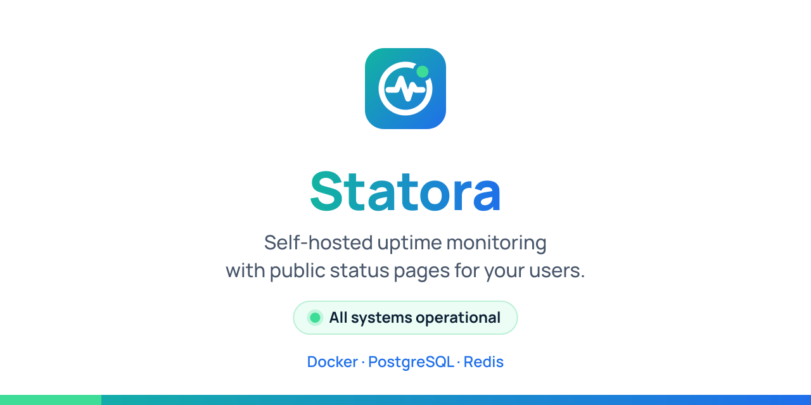

  <a href="https://timothestoifl24.dev">
    <picture>
      <source media="(prefers-color-scheme: dark)" srcset=".github/readme/profile-panel-dark.svg">
      
    </picture>
  </a>

  At work I keep infrastructure platforms running. At home I run the network and a private cloud for my family.
  The projects here are the tools and apps I build to keep all of that manageable.

  <a href="https://timothestoifl24.dev">Projects</a> ·
  <a href="https://timothe.stoifl.app">My Profile</a> ·
  <a href="https://www.linkedin.com/in/timothestoifl">LinkedIn</a>

## My Projects

<table>
  <tr>
    <td width="50%" valign="top">
      
      <h3><a href="https://github.com/timothestoifl24/bulk-mailer">Bulk Mailer</a></h3>
      Send one message to many recipients: typed, pasted, CSV or pulled from LDAP / Active Directory. Runs fully offline.  
      <code>Python</code> <code>FastAPI</code> <code>SQLAlchemy</code> <code>PostgreSQL</code> <code>LDAP</code> <code>Docker</code>
    </td>
    <td width="50%" valign="top">
      
      <h3><a href="https://github.com/timothestoifl24/statora">Statora</a></h3>
      Self-hosted uptime monitoring and status pages: HTTP/TCP/ping/DNS checks, incidents, maintenance and SSO.  
      <code>Python</code> <code>FastAPI</code> <code>PostgreSQL</code> <code>Redis</code> <code>Docker</code>
    </td>
  </tr>
</table>

All projects: **[timothestoifl24.dev](https://timothestoifl24.dev)**

This repo also holds the source of timothestoifl24.dev. How it works: [docs/README.md](docs/README.md).
